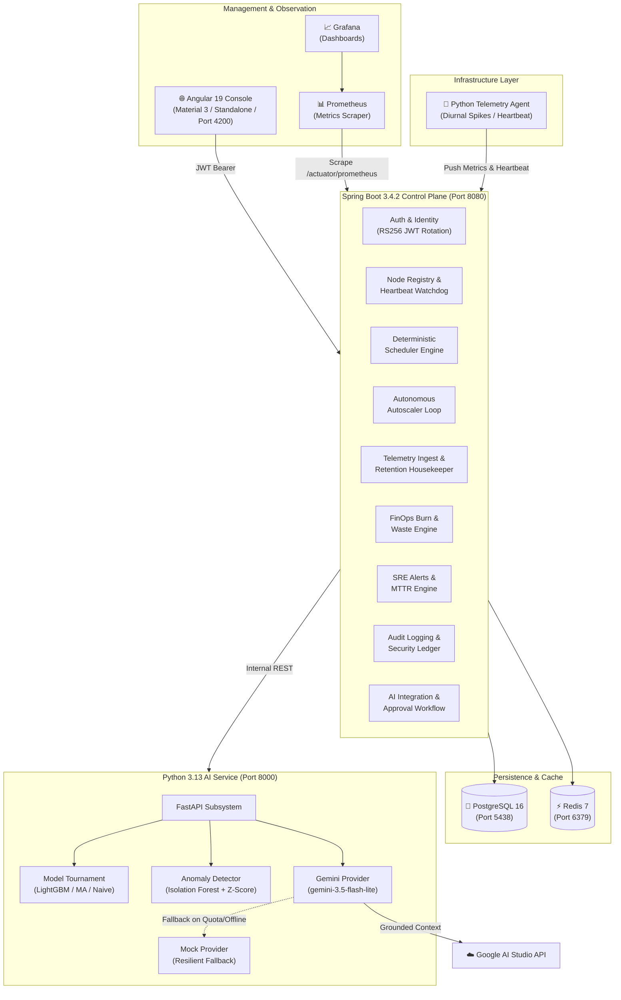

# CloudScale

> **Intelligent Cloud Infrastructure Management & Predictive Resource Orchestration Platform**

[](https://opensource.org/licenses/MIT)
[](https://openjdk.org/)
[](https://spring.io/projects/spring-boot)
[](https://angular.dev/)
[](https://fastapi.tiangolo.com/)
[](https://ai.google.dev/)
[](https://www.postgresql.org/)
[](https://redis.io/)

---

## 1. Executive Summary

**CloudScale** is an enterprise-grade cloud control plane demonstrating distributed workload scheduling, real resource capacity management, autonomous autoscaling with anti-flapping damping, multi-tenant security isolation, and AI-assisted infrastructure intelligence powered by Google Gemini.

This is **not** a basic CRUD dashboard or static demonstration. It features:
- **Actual Workload Scheduling:** 4 deterministic scheduling algorithms with transactional pessimistic write locks, proven to maintain **0% over-allocation** under multi-threaded concurrency bursts.
- **Autonomous Autoscaling Engine:** Closed-loop horizontal scaling controller evaluating CPU and memory telemetry, bounded by cooldown timers and anti-flapping oscillation damping.
- **AI Infrastructure Intelligence:** Google Gemini (`gemini-3.5-flash-lite`) integration grounded directly in live cluster topology, resource saturation ratios, and diurnal traffic curves.
- **Multivariate Forecasting Tournament:** Automated benchmarking of LightGBM, Moving Average, and Naive Baseline time-series models selecting the lowest MAE/RMSE winner with 95% confidence corridors.
- **FinOps Cost Analytics:** Real-time burn rate accounting and dollar waste detection flagging hosts operating below 20% density.
- **SRE Incident & Alert Center:** Incident management lifecycle tracking real-time Mean Time To Resolution (MTTR).
- **Immutable Audit Ledger:** Tamper-evident operational event stream auditing all infrastructure mutations.

---

## 2. System Architecture



---

## 3. Core Engineering Capabilities

### A. Deterministic Workload Scheduling Engine
The scheduler allocates compute workloads onto registered hosts using four distinct algorithms:

| Algorithm | Time Complexity | Space Complexity | Strategy & Trade-offs |
| :--- | :--- | :--- | :--- |
| `RESOURCE_AWARE` *(Default)* | $O(n \log n)$ | $O(n)$ | Computes composite CPU + memory balance score, placing workload on least-fragmented host. |
| `BEST_FIT` | $O(n \log n)$ | $O(n)$ | Packs workloads tightly onto hosts with minimum remaining residual capacity to free entire nodes. |
| `FIRST_FIT` | $O(n)$ | $O(1)$ | Fast scan selecting the first host satisfying minimum requirements; lowest scheduling latency. |
| `PRIORITY` | $O(n \log n)$ | $O(n)$ | Ranks nodes by headroom, reserving highest-capacity hosts for `CRITICAL` workloads. |

**Concurrency Control & Race Prevention:**
- Workload reservation acquires row-level pessimistic write locks on target nodes (`SELECT ... FOR UPDATE SKIP LOCKED`).
- Verified via a **20-thread concurrent benchmark (`SchedulerStressBenchmarkTest`)**: 20 threads simultaneously hit the scheduler demanding 40 cores across a 32-core cluster; exactly 16 workloads scheduled, 4 safely rejected in **111 ms**, with **0% over-allocation rate**.

---

### B. Autonomous Autoscaling with Anti-Flapping Damping
- Runs an evaluation loop against active scaling policies (`cpu_scale_up_threshold`, `cpu_scale_down_threshold`, `min_replicas`, `max_replicas`).
- Computes time-weighted average metrics over configurable evaluation windows.
- Enforces strict **cooldown timers** (default 300s) and **anti-flapping oscillation damping** to prevent rapid scale-up/scale-down thrashing.
- Every scaling mutation is logged to the `scaling_events` and `audit_logs` tables.

---

### C. Google Gemini Infrastructure Intelligence
- **Model Choice:** Configured for `models/gemini-3.5-flash-lite` (free tier, ultra-low latency, high token throughput).
- **Grounded Context Synthesis:** Does not feed hallucinated statistics to the LLM. Real cluster state (active nodes, CPU utilization percentages, running workloads, and diurnal traffic patterns) is dynamically constructed and injected into system prompts.
- **Provider Abstraction:** Implements an extensible `LLMProvider` interface with `GeminiProvider` and `MockLLMProvider` fallback, ensuring zero downtime if external network access or API quotas are exhausted.
- **Human-in-the-Loop Approval Workflow:** Recommendations generated by AI (`NODE_REBALANCING`, `RIGHTSIZING`, `OVERPROVISIONED`) enter a `PENDING` state and require operator approval (`POST /api/v1/ai/recommendations/{id}/approve`) before execution.

---

### D. Multivariate Capacity Forecasting Tournament
- Benchmarks three distinct algorithms in real-time on host telemetry:
  1. **LightGBM Regressor** with lag features ($t-1, t-2, t-3, t-5$) and rolling mean statistics.
  2. **Moving Average** with configurable smoothing window.
  3. **Naive Baseline** carrying forward recent trajectory.
- Evaluates **Mean Absolute Error (MAE)** and **Root Mean Square Error (RMSE)**.
- Automatically crowns the winning model to generate multi-step horizon projections with 95% confidence corridor bands.

---

### E. FinOps Cost Analytics & Dollar Waste Detection
- Industry-standard reference rates: `$0.048` per CPU core-hour, `$0.006` per GB RAM-hour over a 730-hour baseline.
- Real-time spend accounting computing hourly burn rate, 24-hour amortized daily burn, and projected monthly spend.
- **Waste Analyzer:** Flags hosts operating below **20% density** as underutilized, quantifies unallocated cores and memory, and calculates monthly wasted spend in USD with consolidation suggestions.

---

### F. SRE Incident Center & MTTR Tracking
- Manages infrastructure alerts (`ACTIVE` -> `RESOLVED`) across `CRITICAL`, `HIGH`, `MEDIUM`, and `LOW` severity tiers.
- Computes real-time **Mean Time To Resolution (MTTR)** in minutes across the sliding 24-hour operational window.
- Features an incident simulation trigger for demonstration and automated testing.

---

### G. Security Architecture & Multi-Tenancy
- **Authentication:** Stateless access tokens signed with **RS256** (RSA key pair generated at startup), 15-minute expiry.
- **Refresh Token Rotation:** Single-use refresh tokens stored securely in PostgreSQL with instant revocation via Redis.
- **Brute-Force Protection:** 5 consecutive failed login attempts trigger an automatic 15-minute account lockout.
- **Tenant Isolation:** Enforces organization-level boundaries at the service and query layers (`WHERE organisation_id = :currentOrgId`). Cross-tenant access is tested and rejected with HTTP 404/403.
- **Immutable Audit Trail:** Records all operational mutations with actor email, resource type, client IP, and UTC timestamps.

---

## 4. REST API Catalog

| Module | Method | Endpoint | Description | Auth Required |
| :--- | :--- | :--- | :--- | :--- |
| **Auth** | `POST` | `/api/v1/auth/register` | Register new organization & admin | No |
| **Auth** | `POST` | `/api/v1/auth/login` | Authenticate and obtain JWT pair | No |
| **Auth** | `POST` | `/api/v1/auth/refresh` | Rotate refresh token for new access token | No |
| **Auth** | `POST` | `/api/v1/auth/logout` | Revoke active refresh token in Redis | Yes |
| **Nodes** | `GET` | `/api/v1/nodes` | List registered compute nodes | Yes |
| **Nodes** | `POST` | `/api/v1/nodes` | Register a new compute node | Yes |
| **Nodes** | `POST` | `/api/v1/nodes/{id}/heartbeat` | Record node heartbeat ping | No |
| **Workloads** | `GET` | `/api/v1/workloads` | List organization workloads | Yes |
| **Workloads** | `POST` | `/api/v1/workloads` | Submit workload & trigger scheduler | Yes |
| **Workloads** | `POST` | `/api/v1/workloads/{id}/stop` | Stop running workload & release capacity | Yes |
| **Metrics** | `POST` | `/api/v1/metrics` | Ingest time-series telemetry sample | Yes |
| **Metrics** | `GET` | `/api/v1/metrics/cluster/summary` | Retrieve aggregate cluster utilization | Yes |
| **Autoscale** | `GET` | `/api/v1/autoscaling/policies` | List autoscaling policies | Yes |
| **Autoscale** | `POST` | `/api/v1/autoscaling/simulate` | Trigger autonomous scaling evaluation loop | Yes |
| **AI** | `POST` | `/api/v1/ai/chat` | Dialogue with Gemini grounded in cluster state | Yes |
| **AI** | `GET` | `/api/v1/ai/recommendations` | List AI optimization suggestions | Yes |
| **AI** | `POST` | `/api/v1/ai/recommendations/{id}/approve` | Operator approval of AI recommendation | Yes |
| **AI** | `POST` | `/api/v1/ai/diagnose` | Run Gemini root cause diagnosis | Yes |
| **AI** | `GET` | `/api/v1/ai/forecast/nodes/{id}` | Capacity forecast tournament & trajectory | Yes |
| **Cost** | `GET` | `/api/v1/cost/summary` | Real-time burn rate & projected spend | Yes |
| **Cost** | `GET` | `/api/v1/cost/waste` | Dollar waste & underutilized node analysis | Yes |
| **Alerts** | `GET` | `/api/v1/alerts` | List active & resolved infrastructure alerts | Yes |
| **Alerts** | `GET` | `/api/v1/alerts/metrics` | Retrieve live MTTR & severity distribution | Yes |
| **Audit** | `GET` | `/api/v1/audit/logs` | Query immutable operational audit ledger | Yes |

---

## 5. Technology Stack Justification

| Component | Choice | Justification |
| :--- | :--- | :--- |
| **Backend** | Java 21/25 + Spring Boot 3.4.2 | Strongly typed, rock-solid concurrency primitives (`CountDownLatch`, pessimistic locks), Spring Data JPA, and Flyway database migrations. |
| **Frontend** | Angular 19 Standalone | Enterprise component structure, Angular Signals for reactive state, Material 3 design tokens, strict TypeScript typing, and fast production bundles. |
| **AI/ML** | Python 3.13 + FastAPI | Native ecosystem for scikit-learn, LightGBM, and Google GenAI SDK (`google-genai`). Kept strictly decoupled from infrastructure authority. |
| **Primary DB** | PostgreSQL 16 | Relational consistency, transactional resource reservations, JSONB payload support, and time-series composite indexing. |
| **Cache/Auth** | Redis 7 | Instant $O(1)$ token revocation checks and distributed lockout tracking. |
| **Observability**| Micrometer + Prometheus + Grafana | Standard Prometheus metric scraping at `/actuator/prometheus` and pre-configured Grafana dashboards. |

---

## 6. Local Quickstart

### Step 1: Start Infrastructure Containers
```bash
cd infra
docker compose up -d
```

### Step 2: Run the Verification Suite
To verify the entire monorepo in one command:
```bash
./scripts/run-checks.sh
```

### Step 3: Start Services for Local Development
1. **Control Plane:**
   ```bash
   cd control-plane
   mvn spring-boot:run
   ```
2. **AI Microservice:**
   ```bash
   cd ai-service
   source .venv/bin/activate
   export GEMINI_API_KEY="your-gemini-key"
   uvicorn app.main:app --port 8000 --reload
   ```
3. **Node Telemetry Agent:**
   ```bash
   cd node-agent
   source .venv/bin/activate
   python -m app.main
   ```
4. **Angular Management Console:**
   ```bash
   cd console
   npm start
   # Navigate to http://localhost:4200
   ```

---

## 7. Verification & Benchmark Evidence

All 4 test suites pass cleanly across every tier:

```text
==========================================
 Running CloudScale Automated Verification 
==========================================
--> 1. Testing Control Plane (Java/Maven)...
    [INFO] Tests run: 43, Failures: 0, Errors: 0, Skipped: 0
    ✅ Control Plane tests PASSED

--> 2. Testing AI Service (Python/Pytest)...
    6 passed, 1 warning in 10.26s
    ✅ AI Service tests PASSED

--> 3. Testing Node Agent (Python/Pytest)...
    3 passed in 0.34s
    ✅ Node Agent tests PASSED

--> 4. Testing Angular Console (Production Build)...
    Application bundle generation complete. [3.614 seconds]
    14 chunks built, 0 errors, 0 warnings
    ✅ Angular Console build PASSED

==========================================
 All CloudScale checks completed cleanly! 
==========================================
```

---

## 8. Extensibility Roadmap

While the initial implementation runs on local Docker containers and simulated infrastructure nodes, the control plane is architected with clean interfaces to support:
- **Kubernetes Operator:** Implementing `KubernetesSchedulerAdapter` to schedule real Pods onto K8s worker nodes via the Kubernetes API.
- **KVM / Libvirt Integration:** Direct VM hypervisor orchestration for bare-metal cloud deployments.
- **Cloud Provider Drivers:** AWS, GCP, and Azure provisioning adapters implementing the `NodeRegistry` and `WorkloadScheduler` contracts.

---

## 9. Author & License

- **Author:** Harshal Raaj Patnaik ([@harshalraajpatnaik](https://github.com/harshalraajpatnaik))
- **License:** MIT License. See [LICENSE](LICENSE) for details.
