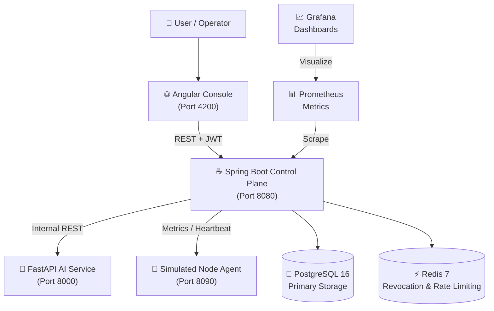

# CloudScale

> **Intelligent Cloud Infrastructure Management & Predictive Resource Orchestration Platform**

[](https://opensource.org/licenses/MIT)
[](https://openjdk.org/)
[](https://spring.io/projects/spring-boot)
[](https://angular.dev/)
[](https://fastapi.tiangolo.com/)
[](https://www.postgresql.org/)
[](https://redis.io/)

CloudScale is a working miniature cloud control plane with actual workload scheduling, resource allocation, infrastructure monitoring, predictive autoscaling, and AI-assisted infrastructure intelligence. Designed as an enterprise-grade portfolio platform demonstrating distributed systems, resilient scheduling algorithms, multi-tenant security, and machine learning operations.

---

## Architecture at a Glance



---

## Core Capabilities

1. **Multi-Tenant Control Plane**: Complete organization-level isolation with hierarchical RBAC (`SUPER_ADMIN`, `ORGANISATION_ADMIN`, `INFRASTRUCTURE_OPERATOR`, `VIEWER`).
2. **Infrastructure Node Registry**: Lifecycle state transitions (`PENDING`, `ACTIVE`, `DRAINING`, `INACTIVE`), heartbeat detection, and dynamic capacity tracking.
3. **Deterministic Workload Scheduling**: Pluggable scheduling engine with **Resource-Aware** (default), **Best-Fit**, **First-Fit**, and **Priority-Based** algorithms, protected against race conditions via transactional resource reservations.
4. **Autonomous Autoscaling Engine**: Rule-based threshold evaluation with cooldown windows, scale-up/scale-down bounds, and predictive foresight safety checks.
5. **Predictive Capacity Forecasting**: Time-series pipeline evaluating naive, rolling-average, SARIMA, and LightGBM models against held-out validation sets.
6. **Infrastructure Intelligence Assistant**: Scoped, tool-calling AI assistant (Gemini API) querying live metrics, workload states, alerts, and cost optimizations through authorized APIs.
7. **Comprehensive Observability**: OpenTelemetry instrumentation, Prometheus metrics export, and preconfigured Grafana enterprise dashboards.

---

## Quick Start (Development)

### Prerequisites
- **Java**: OpenJDK 21 or 25
- **Node.js**: 20+ (Node 26 LTS tested) & npm
- **Python**: 3.12+ (Python 3.13 tested)
- **Docker & Docker Compose**: 24+

### Setup
```bash
# 1. Clone repository
git clone https://github.com/harshalraajpatnaik/CloudScale.git
cd CloudScale

# 2. Configure environment
cp .env.example .env
# Edit .env with your preferred passwords and credentials

# 3. Start backing services (PostgreSQL, Redis, Prometheus, Grafana)
cd infra && docker compose up -d

# 4. Run Spring Boot Control Plane
cd ../control-plane && ./mvnw spring-boot:run

# 5. Run Python AI Service
cd ../ai-service && pip install -r requirements.txt && uvicorn app.main:app --reload --port 8000

# 6. Run Angular Console
cd ../console && npm install && npm start
```

---

## Documentation

Comprehensive architecture, API contracts, threat models, and operational runbooks are located in the [`docs/`](./docs) directory:

- [System Overview](./docs/system-overview.md)
- [Product Requirements](./docs/product-requirements.md)
- [Architecture Specifications](./docs/architecture/)
- [Architecture Decision Records (ADRs)](./docs/adr/)
- [API Documentation](./docs/api/)
- [Database Schema & ERDs](./docs/database/)
- [AI/ML Methodology](./docs/ai/)
- [Security Architecture](./docs/security/)
- [Testing & Quality Assurance](./docs/testing/)
- [Beginner's Learning Guide](./docs/learning-guide-for-beginners.md)

---

## License

This project is licensed under the [MIT License](./LICENSE).
