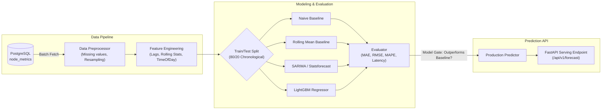

# AI & Machine Learning Architecture — CloudScale

## 1. Objectives & Boundaries
The Python AI service (`ai-service/`) provides intelligence capabilities to CloudScale without usurping control plane authority:
- **Time-Series Forecasting**: Predict host and workload CPU/memory requirements over 5m, 15m, and 30m horizons.
- **Anomaly Detection**: Flag abnormal resource surges or memory leaks before outages occur.
- **Infrastructure Intelligence Assistant**: Empower operators with an interactive conversational agent grounded in live infrastructure state via Gemini function calling.

## 2. Model Pipeline Architecture

## 3. Evaluation & Validation Gate
No machine learning model is deployed or served as active unless it mathematically beats the 5-point moving-average baseline on held-out test data:
$$\text{RMSE}_{\text{LightGBM}} < \text{RMSE}_{\text{MovingAverage}}$$
Evaluation results are output in JSON and archived for auditable performance tracking.

## 4. Anomaly Detection Methodologies
1. **Statistical Z-Score**: Flags points where $|z| = \frac{|x - \mu_{window}|}{\sigma_{window}} > 3.0$.
2. **Interquartile Range (IQR)**: Robust to outliers; detects points $< Q_1 - 1.5 \times \text{IQR}$ or $> Q_3 + 1.5 \times \text{IQR}$.
3. **Isolation Forest**: Unsupervised tree ensemble trained on multidimensional metric vectors (CPU%, Memory%, Disk I/O, Network I/O) to capture multivariate anomalies.

## 5. Gemini Function Calling & Tool Sandboxing
The AI Assistant communicates with Gemini via function calling tools:
- `getNodeMetrics(nodeId)`: Returns current and recent CPU/memory metrics.
- `getWorkloadDetails(workloadId)`: Returns state, resource requests, and host assignment.
- `getScalingHistory(workloadId)`: Returns past scaling events and triggers.
- `getInfrastructureAlerts(severity)`: Returns active warnings and critical incidents.
- `getCapacityForecast(horizon)`: Returns multi-step capacity predictions.
- `getCostAnalysis(orgId)`: Returns current cost burn rate and underutilized node candidates.

All tool executions are executed by the FastAPI server proxying to the Spring Boot control plane with the user's validated JWT. The LLM cannot perform SQL commands, file operations, or container commands.
