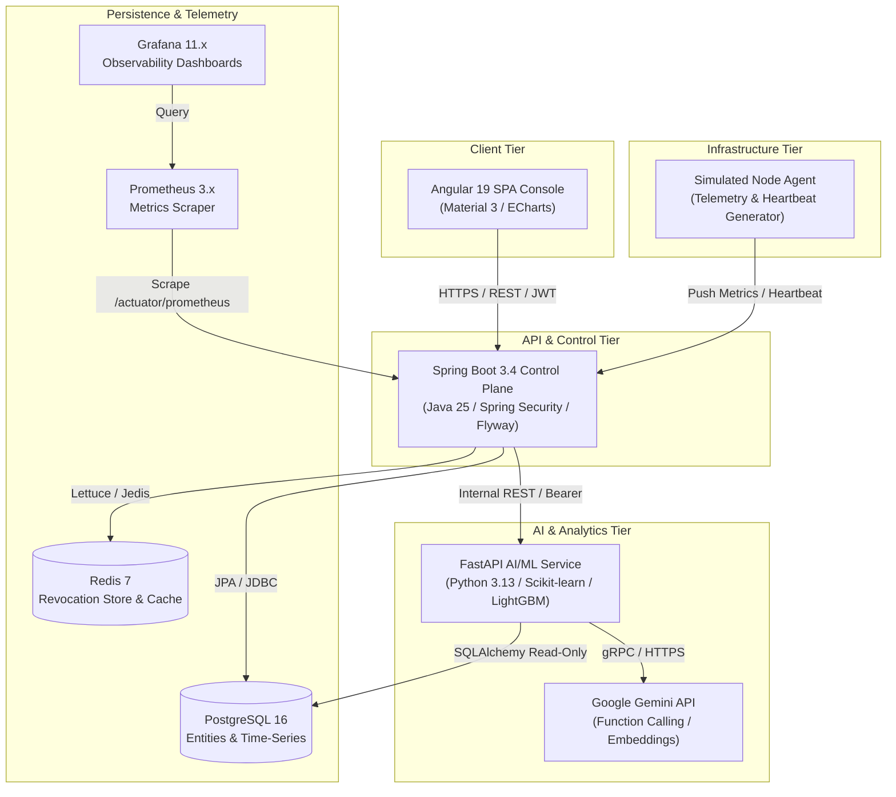

# CloudScale System Overview

## 1. System Mission
CloudScale is a distributed, multi-tenant cloud control plane engineered to simulate and manage compute infrastructure, schedule workloads with deterministic mathematical guarantees, ingest live telemetry, execute rule-based and predictive autoscaling, and deliver AI-grounded operational diagnostics.

## 2. High-Level Architecture

## 3. Core Subsystems

### A. Angular Management Console (`console/`)
A responsive, modern single-page application built on Angular 19, Angular Material 3, and Apache ECharts. It communicates with the control plane through typed HTTP services, using reactive streams (RxJS) for live telemetry updates and state management.

### B. Java Spring Boot Control Plane (`control-plane/`)
The authoritative source of truth for the entire platform. Built with Java 25 and Spring Boot 3.4. It handles identity, tenant isolation, node lifecycle, workload scheduling, concurrency control, rule-based autoscaling, metric ingestion, and audit trails.

### C. Python AI/ML Intelligence Service (`ai-service/`)
A high-performance asynchronous service built on Python 3.13 and FastAPI. It trains and executes time-series capacity forecasting models, performs statistical and ML-based anomaly detection, and hosts the Gemini-powered infrastructure assistant with sandboxed function calling tools.

### D. Simulated Infrastructure Node Agent (`node-agent/`)
A Python service simulating real physical or virtual machine nodes. It generates realistic CPU, memory, and I/O workloads with diurnal patterns, intermittent spikes, and health status reporting back to the control plane.

### E. Data & Telemetry Layer (`infra/`)
Containerized infrastructure managed via Docker Compose:
- **PostgreSQL 16**: Relational schema managed via Flyway database migrations.
- **Redis 7**: High-speed token revocation store and rate-limiting cache.
- **Prometheus & Grafana**: System and application telemetry scraping and visualization.
